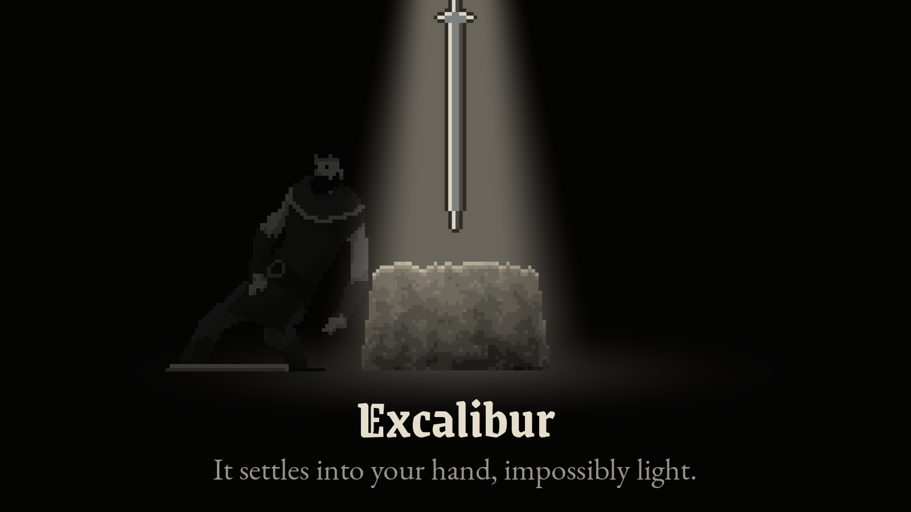

# Mythworn

**A narrative roguelike deckbuilder where your Passion, not your morality, decides who you become.**

Camelot has no king, and the devices are fading from its shields. You play a keeper, sent in to preserve what is left. The cards you play move your Passion toward one of the keeper's two selves, and the self you lean into decides which cards hit harder and which you are offered next.

Mythworn is in development at [Oddseed Games](https://oddseedgames.com), a one-person studio, and is built in Godot 4.4 and GDScript. There is no download yet. For now it can only be run from its code, in the Godot editor, as [Run it](#run-it) describes.

Follow the game at [mythworn.com](https://mythworn.com) or on [Discord](https://discord.gg/cyk9Q74pYn). How it is built: [the architecture notes](docs/ARCHITECTURE.md).



*The Sword in the Stone waits at the centre of every Camelot map. Draw it or leave it: the run remembers either.*

## The game

A run in the current build is one act of Camelot.

- **The pledge.** You are sent off, and at the gate you pledge yourself to the court or to the common folk. The pledge is applied before the map is drawn. It adds elites or weakens them, moves prices and rewards, and opens some options in later events while closing others.
- **The map.** You climb a branching map of fights, events, shops and rests, with the Sword in the Stone at its centre and Sir Caedmon, who was Camelot's champion, at the top.
- **Combat.** It is turn-based card play: three energy, a hand of five, and enemies that show what they intend to do.
- **The story.** Between fights it is written by hand: events that remember what you chose earlier, a questline that crosses the map, and relics that have lost their names until a place that keeps records reads them back.

## Engineering

In plain terms: the same starting number, called a seed, always produces the same map and the same encounters, so a result can be reproduced and two versions of the code can be compared. Every change is checked by more than 700 automated tests. A separate checker catches content that points at something that does not exist. More than a quarter of the code in this repository is this testing and checking code.

[docs/ARCHITECTURE.md](docs/ARCHITECTURE.md) covers the structure, what each decision cost and what is still rough.

### Deterministic runs

Two commits can only be compared if the same seed gives the same rolls, and Godot's `Array.shuffle()` draws from the engine's global generator, outside the run's seed. So one run seed feeds five separate streams (deck, enemy, loot, event, map), and every shuffle that decides gameplay goes through one Fisher-Yates that is handed the stream to draw from.

`tools/realm_route_proof` is the check on it. For 40 seeds under three realm configurations it prints each map and the encounters and events along a route through it. Run it on two commits and diff the two outputs: a change that was not meant to move the map or its content shows up as a line in the diff.

### Balance measured on the shipped engine

A separate model of the rules, in Python, fell out of step with the game. The harness that replaced it drives the real `CombatEngine` with no screen loaded, so its fights run on the game's own rules.

The harness's player plans each turn on a forward model of the fight, a second and lighter copy of the rules. `--verify` checks that copy against the engine, before each card and before each enemy turn it can predict: about 33,000 comparisons across 11 loadouts and 5 fights. Two of them are known to disagree, each by 3 HP on a player with 80: a small gap, not yet traced to its cause.

### A content linter with mutation tests

Content names other content by id: an event awards a title, a quest names its payoff. A wrong id fails silently. `tools/content_linter` gathers every registry into one dictionary and runs 20 rules over it, each a pure function. Its self-test hands a rule a copy of that dictionary with one bug planted in it, and the run fails if the rule stays quiet. All 20 rules have such a case.

### Behaviour checks on real content

`tools/roster_test` makes more than 700 assertions against the enemies, cards, relics, titles and maps the game itself builds, with no screen loaded.

### Four files to open first

- [scripts/autoloads/rng_manager.gd](scripts/autoloads/rng_manager.gd): the streams, 57 lines
- [scripts/core/combat_engine.gd](scripts/core/combat_engine.gd): the rules of a fight
- [tools/content_linter.gd](tools/content_linter.gd): the rules and their self-test
- [tools/harness_combat.gd](tools/harness_combat.gd): the planner and its forward model

## Design

### Passion, not morality

Passion is a signed meter with a 'self' at each end. For the first keeper the high end is Water, which is fast, fragile and controlling, and the low end is Physical, which is slower, armoured and hits once, hard. Cards move the meter as you play them, enemies can drag it, and it carries from fight to fight for the whole run.

Five tiers sit along it: Hollow, Wavering, Steady, Inspired and Blazing. Two things read the tier:

- **Damage.** Attacks from the self you lean into hit harder, by 12% at a leaning tier and 25% at an extreme, and attacks from the other self hit softer by the same amount.
- **Rewards.** The cards you are offered come from that self's pool: two of three at an extreme, one of three at a leaning tier, none at Steady.

### Two selves, one deck

Each keeper has two card pools, one for each self, and shares a generic pool. Neither self is the good one. Each stands for some good and some bad in the keeper. Because Passion decides what you are offered, the deck you finish with is a record of who you were for most of the run.

### A realm set before you walk it

A realm's state is decided in a short story scene before its map exists. In Camelot that is the pledge. It produces one `RealmConfig` (enemy strength, the count of elites, shop prices, reward rarity, a starting boon, a Passion shift and your standing with court and folk), which shapes the map and which fights, shops and events read for the rest of the act.

### Titles instead of equipment

There is no equipment. A keeper wears up to two titles, and each is earned by something they did: drawing the sword, refusing it, holding the people's line. A title that belongs to a realm weakens away from it. A title that belongs to the keeper's own conduct travels with them.

## Status

The game is in development. This repository holds the demo slice: one act of Camelot and one keeper, playable from the title screen to Sir Caedmon. It has about 60 cards, more than 40 relics, 20 enemies, 11 titles, 11 consumables, three companions, and 11 written events beside the questline and set-piece scenes.

The numbers have not had their balance pass. The sprites and the sound are stand-ins: CC0 art put through the bake tools in `tools/`, and synthesised placeholder audio.

## Run it

There is no download yet, so the game runs from source. It is developed on Windows.

1. Install [Godot 4.4](https://godotengine.org/download/archive/4.4-stable/), the standard build (not the .NET one).
2. Clone the repository and open `project.godot` in the editor. The first open imports the art.
3. Press F5.

The checks run from the project folder with no window, once the editor has opened the project. In these commands `godot` stands for your Godot 4.4 executable:

```
godot --headless --path . res://tools/roster_test.tscn
godot --headless --path . res://tools/content_linter.tscn
godot --headless --path . res://tools/combat_harness.tscn -- --verify
```

`roster_test` takes a minute or two and ends on `ALL PASS`. The linter takes a few seconds and ends on `LINT CLEAN`. The harness takes about a minute, prints its count of comparisons and mismatches, and exits 1 while the two known mismatches stand. There is no CI yet: the checks are run by hand before each commit.

## Licence

All rights reserved. The repository is public so that the code can be read; see [LICENSE](LICENSE). Third-party art and fonts keep their own licences, which are listed in [assets/sprites/CREDITS.md](assets/sprites/CREDITS.md).
